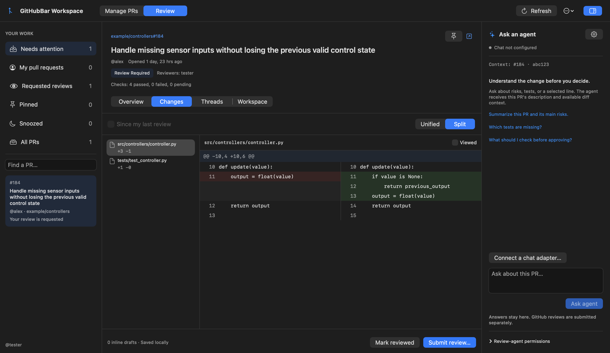
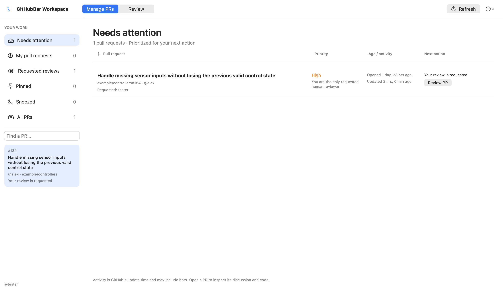
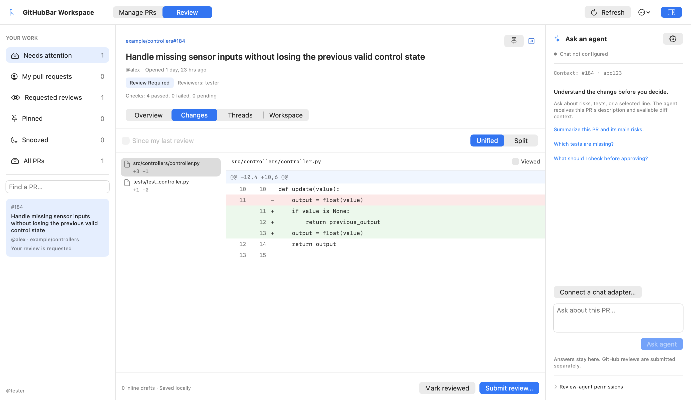

# GitHubBar

**Your pull requests, code reviews, and coding agents—in one native Mac workspace.**

[](https://github.com/nikovert/GitHubBar/releases)
[](https://www.swift.org/)

Keep your review queue in the menu bar. Open the full workspace to prioritize PRs,
read diffs, draft and submit reviews, ask an agent questions, and jump into the
terminal session attached to your worktree.

[**Download v0.6.0 for macOS**](https://github.com/nikovert/GitHubBar/releases/download/validation-v0.6.0-1/GitHubBar-validation-0.6.0-e922826d588c.zip) · [SHA-256](https://github.com/nikovert/GitHubBar/releases/download/validation-v0.6.0-1/GitHubBar-validation-0.6.0-e922826d588c.zip.sha256) · [Release notes](https://github.com/nikovert/GitHubBar/releases/tag/validation-v0.6.0-1) · [Build from source](#build-from-source)



*The native review workspace in dark mode. Screenshots use example PR data; the
chat panel is shown before connecting an agent.*

> This is a development fork of
> [FranciscoMoretti/GitHubBar](https://github.com/FranciscoMoretti/GitHubBar), with a
> larger management workspace, in-app code review, and local agent integrations.
> The v0.6.0 validation download includes the workspace shown in these screenshots.

## Know what needs your attention

- **One place for your PRs and review requests.** Switch between Needs attention,
  My pull requests, Requested reviews, Pinned, Snoozed, and All PRs.
- **Recognize the work immediately.** See titles, authors, requested reviewers,
  review status, age, activity, and the next action alongside each PR.
- **Priorities with a reason.** Set a manual priority, inherit one from a stack,
  or use automatic ranking that favors PRs where you are the sole requested human
  reviewer. Configure priority authors to surface the work that matters to you.
- **Keep your own context.** Add notes and extended status tags to PRs and stacks,
  pin important work, or snooze a PR for 24 hours. Compatible agents can update
  priorities, notes, and status through the bundled workspace CLI.
- **Keep the menu bar useful.** Scan review workflow sections, reviewer avatars,
  and compact PR stacks. Filter to a device-local set of repositories and open the
  menu with <kbd>⌥</kbd><kbd>⌘</kbd><kbd>G</kbd>.
- **Choose your appearance.** Follow macOS or choose Light or Dark in Settings.



*Manage PRs in light mode. Activity uses GitHub's update timestamp, which can include bots.*

## Review code inside the app

- **Unified and split diffs** with file navigation, line numbers, resizable file
  lists, and a hideable agent panel for more reading space.
- **Overview, Changes, Threads, and Workspace tabs** for the description, checks,
  conversation, code, local notes, and attached sessions.
- **Inline drafts and review submission.** Select a line, save a comment locally,
  then explicitly submit a Comment, Approval, or Request changes review to GitHub.
- **Pick up where you left off.** Mark files viewed, save a local review baseline,
  and use **Since my last review** to inspect subsequent changes.
- **Drafts stay attached to the code you reviewed.** State is scoped to the account,
  PR, head, and base. Earlier drafts remain accessible when the diff changes;
  failed submissions retain them.

<details>
<summary>See unified diffs in light mode</summary>



</details>

Incomplete and binary patches are identified explicitly, with links to GitHub for
missing code. Viewed-file state and review baselines are local to this Mac.

## Ask an agent about the code

Ask “What tests are missing?”, “Explain this change,” or a question about a selected
diff line without switching away from the PR. The agent receives the description,
a bounded diff excerpt, selected-line context, and recent conversation. Answers can
include clickable file/line citations.

In **Settings → Workspace chat**, choose **Use an installed CLI…** for a locally
authenticated Codex or Claude CLI, or connect any command implementing the
[JSON chat protocol](docs/agent-chat.md). CLI presets use the bundled Python adapter
and require Python 3. Chat is optional; the app works without an agent.

For background reviews, connect a compatible worker in **Settings → Review agent**.
Request or re-request a review from a PR, then follow its queued, running, completed,
or failed status. Control fixes (**off**, **low risk**, or **all**), comments, and
replies with PR and stack policies. Defaults keep fixes and replies off, and allow
review comments only on your own PRs.

Chat and background reviews have separate connections: chat answers are advisory;
background workers enforce their configured write policies. A general coding CLI
needs a separate compatible worker adapter to consume review requests. See
[review-worker setup](docs/agent-reviews.md).

## Keep worktrees and agent sessions attached to the PR

Create a Codex or Claude worktree/tmux session, or pin an existing session to a PR
or stack. **Jump to session** brings you back to the terminal work for that PR.

When the work is merged, **Clean up merged worktrees…** previews eligible worktrees
with PR titles and short descriptions. Cleanup checks repository state and sync
with origin. If sessions are attached, choose whether to stop all eligible sessions
or review the list and select individually.

The [agent workspace guide](docs/agent-workspace.md) covers checkout configuration,
terminal sessions, stack inheritance, and updates through `GitHubBarWorkspaceCLI`.

## Find a PR by what it changes

**Search PRs** matches titles, descriptions, changed file paths, and available diff
content. Results show **In your list** first, followed by **Extended results** from
the repositories you select—including open, draft, merged, and closed PRs.

Click a result or menu PR to open it in the workspace. Right-click a PR in the
search results or menu to go directly to GitHub. Search is literal and
case-insensitive; it does not send code to a model. Coverage and progress indicators
show when a scan is incomplete. See the [search guide](docs/pr-search.md).

## Install

GitHubBar requires **macOS 14 or newer** and supports **Apple Silicon and Intel**.

1. Install and sign in to [GitHub CLI](https://cli.github.com/):

   ```sh
   brew install gh
   gh auth login
   ```

2. Download the [v0.6.0 app ZIP](https://github.com/nikovert/GitHubBar/releases/download/validation-v0.6.0-1/GitHubBar-validation-0.6.0-e922826d588c.zip) and its
   [SHA-256 checksum](https://github.com/nikovert/GitHubBar/releases/download/validation-v0.6.0-1/GitHubBar-validation-0.6.0-e922826d588c.zip.sha256).
   This universal build supports both Apple Silicon and Intel Macs.
   [Release notes](https://github.com/nikovert/GitHubBar/releases/tag/validation-v0.6.0-1) describe the included features.

3. Verify the downloaded ZIP, then unzip and move `GitHubBar.app` to **Applications**:

   ```sh
   cd ~/Downloads
   shasum -a 256 --check GitHubBar-validation-*.zip.sha256
   ```

Validation builds are ad-hoc signed and not Apple-notarized. If macOS blocks the
first launch, use **System Settings → Privacy & Security → Open Anyway** after
verifying the checksum. The fork uses `com.nikovert.githubbar`, separate from upstream.

Use **Settings → Updates → Download Updates…** to open the releases page. Quit the
app before replacing it with a newer download. Validation builds do not install
updates automatically; Developer ID signing and notarization remain future work.

## Build from source

Install full Xcode, select its developer tools, then run from this repository:

```bash
brew install xcodegen gh tmux
scripts/generate-project.sh
open GitHubBar.xcodeproj
```

Build and run the `GitHubBar` scheme. Authenticate `gh`, open **Workspace Board**,
and select a PR. The **Workspace** tab contains checkout and worktree-root setup.
Install and authenticate `codex` or `claude` to use their optional session/chat
integrations; terminal automation may prompt for macOS permission on first use.

To create a universal validation ZIP locally without installing the app:

```bash
GITHUBBAR_VERSION=0.6.0 scripts/package-validation.sh
```

The ZIP and checksum are written to `dist/`. The app bundles
`GitHubBarWorkspaceCLI`, the chat adapter, and its setup guide. See
[packaging checks](docs/agent-reviews.md#build-and-verify) before overriding paths.

For the review-workspace implementation, **154 core tests, 59 app tests, and 11
adapter tests passed**, alongside Swift 6 concurrency checks and light/dark render
inspection. See the [validation report](docs/releases/2026-10-26-review-workspace-validation.md)
for scope and limits. Run `scripts/check.sh` before contributing.

## Local state and privacy

GitHubBar uses your existing GitHub CLI login. GitHub tokens stay in memory;
preferences, drafts, notes, and cached PR data stay on your Mac. Diagnostics omit
repository names, PR titles, usernames, and credentials.

When you ask an agent a question, PR context is passed to your configured local
adapter. That adapter may send it to its model provider using your existing login.
Choose an adapter and provider appropriate for the repositories you review.

## Credits

Based on [GitHubBar by Francisco Moretti](https://github.com/FranciscoMoretti/GitHubBar),
with workspace and agent-integration contributions by Nikolaus Vertovec.
